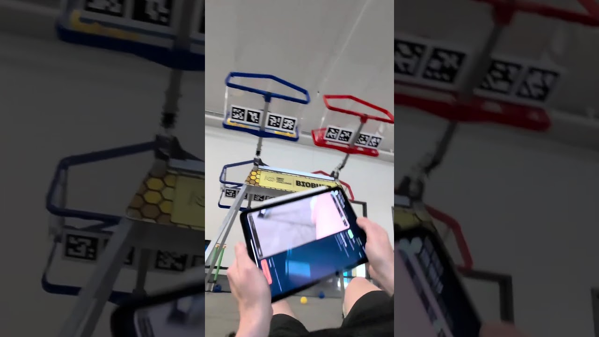
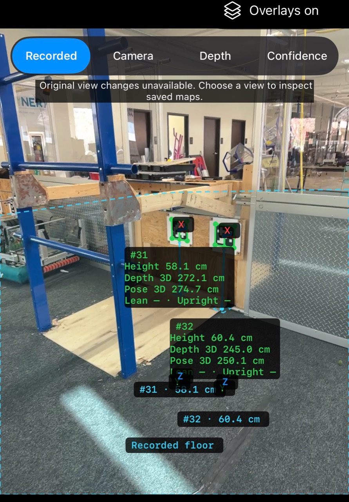
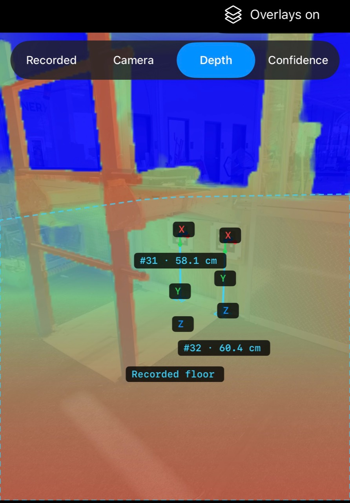
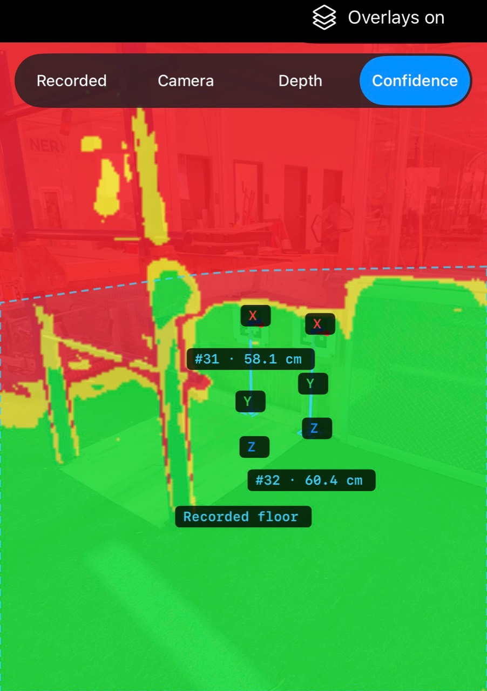

# April Fools AR by The REFINERY

Watch our inaugural test on the practice field at **The REFINERY**.

[](https://www.youtube.com/shorts/Z98nUAI7hSo)

**Watch:** [YouTube Shorts](https://www.youtube.com/shorts/Z98nUAI7hSo) · [The same video on Instagram](https://www.instagram.com/reel/DgGpNEgTw8_/)

Three views from the practice-field test. Select a photo to view it at full size.

| Camera with recorded overlays | LiDAR depth | Depth confidence |
| :---: | :---: | :---: |
| [](docs/images/first-field-test/camera-overlays.jpg) | [](docs/images/first-field-test/depth.jpg) | [](docs/images/first-field-test/confidence.jpg) |

---

A project from [The REFINERY](https://refineryrobotics.org/), owned by **BioNanomics**. Original app code is © 2026 BioNanomics and available under the [MIT license](LICENSE). Third-party code retains its own [licenses and notices](THIRD_PARTY_NOTICES.md). The REFINERY and BioNanomics names and logos identify the project; the software license does not grant trademark rights.

Read the [privacy policy](docs/PRIVACY.md) and [TestFlight preparation](docs/TESTFLIGHT.md). The app also includes its policy, license and notices offline under **by The REFINERY · About**. Apple account setup and TestFlight upload follow owner sign-off.

The **Sponsors** link beside the app title recognizes [Don Wood Foundation](https://www.donwoodfoundation.org/) and [Medical Informatics Engineering](https://mieweb.org/), with links to their official websites. Sponsors are also available in the About screen.

An AprilTag field capture app for iPhone and iPad. Milestone zero detects tags and records real ARKit/LiDAR observations for later analysis; it does not yet solve an AprilTag field calibration.

In landscape, the camera sits beside a tool rail with recording controls kept in reach. Roomy iPad windows use this layout in either orientation; smaller windows return to the compact layout. Floor setup and measurement tools scroll in the rail, settings and release notes use bounded tablet panels, and saved recordings form a grid when space allows. Rotation keeps the current camera session, selected floor, measurements and view zoom.

## On iPhone and iPad

The header shows the installed version, build number and short commit hash. Tap it for **Version and release notes**, including the full source hash, UTC build date and whether the build contains modified sources. New session manifests and recording-start events retain the same identity.

**Tag debug** uses a compact translucent overlay over the full camera preview. It shows validity and pose/LiDAR depth agreement; tap **Details** for translation, orientation, range, angles and decode quality, or **Collapse** to reclaim the view. Each underlined label opens its definition and diagrams in the offline [measurement glossary](docs/tag-metric-glossary.md), maintained in Markdown. Tap a tag to select it. New settings default to **Auto** tag sizing, which uses matching-frame LiDAR to select a supported physical width for each tag. Settings also offers explicit **Field type** (**FTC** or **FRC**) and **Competition year** selections, plus custom widths. FTC seasons 2023–24 through 2026–27 and FRC 2024–2026 have size presets; CENTERSTAGE handles its 2- and 5-inch tags by ID within that selected season. The tag ID and family alone cannot identify the competition. You can enter a measured width or use **Measure tag width with AR**, then review and accept the two-point edge estimate. See [sizes, automatic-selection limits and conventions](docs/tag-debug-screen.md).

**Details → Tag pose (camera-relative)** names its explicit **Pose profile**: **FRC / PhotonVision** by default, with **FTC SDK** and **Raw optical** alternatives in Settings. Each uses its documented camera/tag axes and rotation order; size mode and competition year never choose the coordinate profile. Raw **Pose Z / Scene Z**, **3D dist**, **Incidence**, and **Axis offset** retain separate definitions. FTC planar range excludes camera-relative vertical displacement. App-derived **Lean / Upright** describe gravity-relative tag geometry, independently of SDK pose pitch/roll/yaw. See [pose conventions and examples](docs/decisions/004-pose-conventions.md).

Enable **Show pose axes** in Settings to add red X, green Y and blue Z axes to each solved tag pose. This gizmo retains raw tag-local X printed right, Y printed down and Z into the print, independently of the readout profile.

Use **1× / 2× / 4×** or pinch the live preview for view zoom. It magnifies the image and keeps tag graphics and measurement taps aligned. The recorded RGB/depth and pose calculation keep their original camera calibration; this is display magnification, not a lens change or added optical detail.

Tracking, depth status and zoom controls share one compact line at the top of the preview.

1. Open **April Fools AR** and allow camera access. Use a LiDAR-capable iPhone or iPad for numeric depth recording.
2. Wait for tracking and depth to become available. Point at a `tag36h11` AprilTag to see its ID and corner outline; live detection also runs before recording. The RGB, Depth, and Confidence controls change the preview, not the recorded sensor source.
3. Name the session and choose **Video + facts** for video, sensor samples and tag facts, or **Tag facts only** for a compact YAML walk without saved video, images or sensor buffers. Tap **Start recording**. Walk past tags and floor/structure surfaces, pausing occasionally and returning toward the starting area.
4. In **Measure** mode, tap two visible surfaces to inspect estimated 3D distance and gravity-aligned vertical difference. Tap **Clear** to start another pair. Measurements are estimates, not surveyed truth.
5. Use **Bookmark** to add a tag ID, reference measurement, or observation. The source image is retained with the event.
6. Tap **Stop & save**. **Video + facts** prepares the MP4 automatically; in **Saved sessions**, use **Play** to review its recorded overlays or **Share** to send the recording through AirDrop or Files. **Tag facts only** saves the YAML walk; use **Tags seen** to inspect it or **Share YAML** to export it. In video playback, **Recorded overlays** switches between annotated and clean views. **Delete**, followed by confirmation, permanently removes the selected session and its capture files, including unfinished recordings from earlier runs.

Keep recordings short initially and check an export before the first field visit. Files stay on the phone until you explicitly share them. No server, account, BLE meter, or internet connection is needed for capture.

The capacity meter shows the most restrictive remaining budget: metadata, metadata records, capture files, estimated packaged size or storage needed for saving. Video frame/event logs allow 32 MiB each; generated YAML tracks allow 64 MiB each and saved MP4s remain below 4 GiB. Recordings save automatically at 95% usage to leave finalization room. Package/storage figures are estimates. Facts-only walks keep a bounded aggregate of up to 512 distinct tags, checkpoint the summary up to once per second and use a separate 32 MiB summary budget. Expected tags not seen are listed when a field definition is selected; a walk without a definition can still discover tags.

The app stops and saves an active recording when it goes into the background. Keep it in the foreground while recording. Video mode retains the raw session files alongside each saved MP4 for recovery and analysis, so both use storage until you delete the session. Facts-only walks offer **Share YAML** instead of video playback. **Tags seen → Share YAML** also shares the summary independently of the MP4 for video recordings, including when MP4 preparation is pending.

## Field definitions and field walks

Open **Fields** to select FRC 2026 REBUILT (welded or AndyMark), FTC 2025–2026 DECODE, or FTC 2026–2027 BIOBUZZ. The definitions, source revisions and physical tag sizes are available offline as YAML; the viewer also accepts an imported YAML or JSON definition. Imported geometry uses a new immutable package identity rather than changing official definitions.

For a registered AR view, select the correct field and use **Measure** to confirm its floor, then point at a fixed field tag. A short sequence of qualified observations checks its expected/observed center height, gravity-relative tag lean and printed-up direction. Passing checks establish a **provisional single-tag anchor**; dotted expected tag squares and IDs appear at the reference positions. A mismatch explains the expected and observed values and does not automatically move the field. Missing height is unverified, with an explicitly labeled manual option. Additional tags and return visits check disagreement and drift. Height/lean agreement cannot establish that the anchor's horizontal position or heading is physically correct.

**Start recording** pins the selected package and starts a fresh seen-tag inventory. After **Stop & save**, use **Saved sessions → Tags seen** to review or share its YAML summary (JSON/CSV are also available). Original observations, package bytes/hash, alignment changes and the summary travel inside the self-contained MP4. Recorded overlays reproduce expected geometry during playback and seeking. A field walk can retain nominal tag positions without depth; Auto size still needs usable LiDAR, so choose an explicit size mode when depth is absent.

DECODE tags 20/24 are fixed references; Obelisk tags are not anchors. BIOBUZZ clusters move and have no permanent global position in this catalog. They remain observed tag/cluster evidence rather than stationary alignment controls. Robot consumers and FRC 2027 import remain deferred. Physical accuracy is pending independent field testing; see [the field plan](field-definition-plan.md) and its validation records.

## Capture contents

- `rgb.mp4`: clean, silent H.264 camera video, targeting 30 fps. Live overlays and preview zoom are not burned into the video.
- `frames.jsonl`: timestamped camera poses, intrinsics, image/display geometry, tracking state, frame identity and sample-file links.
- `frames/`: high-quality camera JPEG samples and detection/bookmark/measurement frames.
- `depth/`: packed float32 little-endian camera-plane depth in meters, plus uint8 confidence maps. Depth/image samples target 5 Hz.
- `events.jsonl`: AprilTag detections (including analyzed frames with no tags), measurements, notes, interruptions, resets and session events.
- `manifest.json`: capture settings, device/app information, coordinate conventions, totals, errors and file integrity information.

The recorder uses bounded frame retention. Counters and saved diagnostics identify omitted samples; UI update rate is separate from native capture. A heatmap is only a preview—the numeric depth files are the measurement evidence.

The automatically saved MP4 carries that camera video plus readable session/frame/event YAML and a TAR data track containing the original images, numeric buffers and JSON/JSONL files. A normal external player shows the clean video. In-app playback draws recorded tags, floor heights and measurements over it, synchronized to the video while playing, paused or seeking. **Recorded overlays** starts on and can be switched off without changing the file. Review uses the recorded geometry and available samples; it does not recreate every historical panel, preview zoom or unrecorded UI setting. If overlay metadata is missing or fails its integrity check, the player explains that overlays are unavailable and still plays the clean video.

See [the recording format and extraction commands](recording-format/README.md) and [the capture data conventions](docs/capture-format.md). Install the local extractor with `npm ci --prefix recording-format/npm`, then run `python3 scripts/inspect-session.py /path/to/recording.mp4` to inspect a returned recording. Legacy ZIPs and copied session directories remain readable by the inspector.

## Build

Requirements: Node 22.13 or newer compatible with React Native 0.88, Xcode, CocoaPods, and Ruby's `xcodeproj` gem. Installing on a device additionally requires an existing development team and a profile covering that device.

```sh
npm ci
cd ios
pod install
cd ..
./scripts/build-ios.sh --unsigned --archive
```

This prepares an unsigned Release archive at `/tmp/april-fools-ar-build/AprilFoolsAR.xcarchive` for inspection. It cannot be installed or uploaded until signed. For a local development-signed build using an existing profile, run `IOS_DEVELOPMENT_TEAM=YOUR_EXISTING_TEAM ./scripts/build-ios.sh`. The scripts do not enroll an account, register devices, or update provisioning automatically. Set `APRIL_BUILD_DIR` to change the build directory, or `APRIL_ARCHIVE_PATH` for the archive destination.

`scripts/configure-ios.rb` includes native modules, bundles the legal documents, and configures `com.bionanomics.aprilfoolsar`. Team selection is explicit at build time. The Release build embeds JavaScript and can launch without Metro. The internal workspace, product and React Native module remain `AprilFoolsAR`.

Add each release to the front of `release-notes.json`, with its version, increasing build number and user-facing changes. The configuration script uses that first entry for Xcode's version/build. Both command-line and direct Xcode builds run `scripts/stamp-build-info.sh` before signing to embed fresh source and UTC build metadata in `BuildInfo.json`. A modified working tree is explicitly marked; release builds should come from the committed source.

Before any physical install or test, follow the shared [iOS testing skill](/Users/horner/.codex/skills/ios-testing/SKILL.md), acquire its global device lease and complete verified release afterward. The BioNanomics bundle ID creates a separate app from earlier personal-identifier builds; existing recordings stay with the old app and should be exported before removing it.

```sh
npx tsc --noEmit
npm run lint
npm test -- --runInBand
ruby scripts/bundle-legal.rb --check
```

These development checks do not establish sensor accuracy. [PLAN.md](PLAN.md) keeps the milestone open until a real-field capture is returned and reviewed. [TESTER_CHECKLIST.md](TESTER_CHECKLIST.md) describes that capture.

## Implementation

- React Native/TypeScript: capture controls, session list, bookmarks, export workflow.
- `native/ARCapture/`: Swift ARKit/RealityKit view, measurement probe, native recorder and React Native bridge.
- `native/AprilTag/` and `third_party/apriltag/`: portable AprilTag 3 core, pinned upstream sources and iOS pixel-buffer adapter.
- `native/ArchiveModule/`: streaming self-contained MP4 export without a server dependency.
- `recording-format/`: YAML/MP4 format documentation and npm extraction tools.
- `assets/`: opaque app icon and generation provenance.

The initial detector supports the `tag36h11` family. IDs and image corners do not require knowing tag size; metric pose does. A field calibration solver, Android and BLE integration remain later work. REEKON SDK access status is tracked in [reekon-sprint.md](reekon-sprint.md).

The pinned detector's redistribution notices are in [third_party/apriltag/NOTICE.md](third_party/apriltag/NOTICE.md) and are included in the app bundle. The initial family follows [WPILib's FRC AprilTag documentation](https://docs.wpilib.org/en/latest/docs/software/vision-processing/apriltag/apriltag-intro.html).
