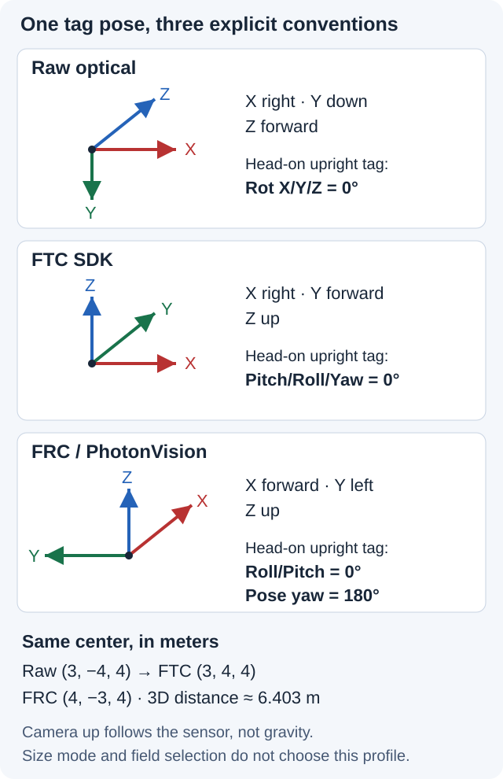
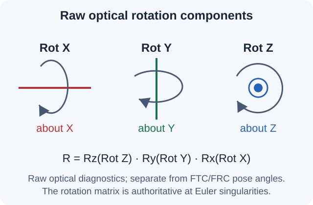
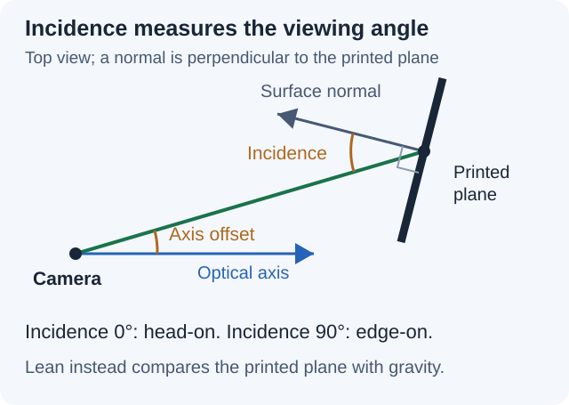

# Tag measurement glossary

## Overview

Tap an underlined label in **Details** to open its definition. This Markdown page and its diagrams are bundled with the app for offline use.

**Tag pose:** [Pose profile](#pose-profile) · [X](#pose-x) · [Y](#pose-y) · [Z](#pose-z) · [Roll](#pose-roll) · [Pitch](#pose-pitch) · [Yaw](#pose-yaw).

**Camera geometry:** [3D distance](#distance) · [FTC planar range](#planar-range) · [Horizontal bearing](#horizontal-bearing) · [Elevation](#elevation) · [Viewing incidence](#viewing-incidence) · [Optical-axis offset](#optical-axis-offset).

**Raw diagnostics:** [Optical coordinates](#camera-coordinates) · [Rot X](#optical-rotation-x) · [Rot Y](#optical-rotation-y) · [Rot Z](#optical-rotation-z) · [Pose Z](#pose-depth) · [Scene Z](#scene-depth) · [|Δ Z|](#delta-z) · [3×3 mean](#depth-mean) · [Confidence](#depth-confidence) · [n/9](#depth-neighbors).

**Gravity and height:** [Gravity](#gravity) · [Lean](#tag-lean) · [Upright](#upright-rotation) · [Height](#height) · [Height source](#height-source) · [Kalman](#kalman).

**Quality and timing:** [RMS](#rms) · [Margin](#decision-margin) · [Hamming](#hamming) · [Edge / Auto / FTC / FRC / year](#edge) · [Hz](#analysis-rate) · [Age](#frame-age) · [Compute](#compute-time) · [Tag ID](#tag-id) · [Status](#status) · [Units](#units).

Measurements describe the tag's **center** unless stated otherwise. A dash (**—**) means unavailable, distinct from measured zero. **Tag pose (camera-relative)** describes the tag relative to the camera; it is separate from the phone's attitude, a robot pose, and a tag's field position. The displayed profile names the axes and rotation convention. Raw diagnostics and gravity angles remain unsmoothed when live height/distance smoothing is enabled. Passing the app's checks does not establish surveyed field accuracy.

## Pose profile

**Pose profile** chooses the convention used for the camera-relative tag translation and rotation. **FRC / PhotonVision** is the default; **FTC SDK** and **Raw optical** are also available. This choice is independent of [Field type and tag sizing](#edge). Auto can infer a nominal width, but cannot determine which pose convention you want or establish competition identity.

- **Raw optical:** camera +X right, +Y down, +Z forward in the original captured sensor image. The tag's local axes are +X printed right, +Y printed down, +Z into the print. A centered, upright tag facing the camera has identity rotation, with Rot X/Y/Z near 0°. The raw rotation uses `R = Rz(Rot Z) Ry(Rot Y) Rx(Rot X)`.
- **FTC SDK:** camera +X right, +Y forward, +Z up in the camera's view. Its tag axes are +X printed right, +Y into the print, +Z printed up, giving a head-on upright tag pitch/roll/yaw near 0°. SDK **Pitch / Roll / Yaw** are rotations about FTC X / Y / Z, respectively, with right-hand signs. The convention is `R = Rz(yaw) Rx(pitch) Ry(roll)`. The app matches the SDK's intrinsic-YXZ extraction from the raw optical matrix and its angle-branch handling.
- **FRC / PhotonVision:** camera +X forward, +Y left, +Z up. The tag's local +X points out of its printed front, +Y points printed right, +Z points printed up. A head-on upright tag therefore has pose yaw 180°, rather than 0°. **Roll / Pitch / Yaw** use right-hand rotation about X / Y / Z and `R = Rz(yaw) Ry(pitch) Rx(roll)`, matching PhotonVision's AprilTag basis correction and WPILib rotation convention.

The camera axes follow the captured sensor orientation. Rotating the phone or rotating/cropping the preview can make them differ from the current screen's right/up. **Up** in a camera profile is camera-relative; gravity-aligned world up is used separately for [Lean and Upright](#gravity). The optional colored pose gizmo retains the raw tag-local axes; changing this readout profile does not rotate that gizmo.

For raw translation `(3, −4, 4)` meters, FTC translation is `(3, 4, 4)` and FRC translation is `(4, −3, 4)`. All describe the same tag center and the same **3D distance ≈ 6.403 m**. FTC planar range is **5 m**, bearing **−36.87°**, and elevation **+45°**.

Camera-relative translation is not field localization. A robot pose requires camera-to-robot extrinsics; a field pose additionally needs an identified field frame and tag layout. A stationary tag's camera-relative rotation can change when the camera turns. [Lean and Upright](#gravity) instead use gravity.

## Pose X

**X** is the tag center's first translation component, in meters: **right** for Raw optical and FTC SDK; **forward** for FRC / PhotonVision. Negative means the opposite direction. It is not a pixel coordinate. The visible [pose profile](#pose-profile) supplies the axis meaning.

## Pose Y

**Y** is the tag center's second translation component, in meters: **down** for Raw optical, **forward** for FTC SDK, **left** for FRC / PhotonVision. These are camera-relative directions, separate from [height above the floor](#height).

## Pose Z component

The **Z translation component** is **forward** for Raw optical and **up** for FTC SDK and FRC / PhotonVision. A camera-profile Z value is separate from the raw diagnostic [Pose Z](#pose-depth), which always means forward **optical Z depth**, regardless of the selected profile.

## Pose roll

**Roll** belongs to the camera-relative tag orientation in the selected profile. FTC SDK roll is about its **Y forward** axis; FRC / PhotonVision roll is about **X forward**. Positive follows the right-hand rule. For FTC, positive roll turns the print clockwise as viewed through the camera. Raw optical uses [Rot X/Y/Z](#optical-rotation-x) to avoid assigning robotics axis names to optical axes.

The rotations are Euler components, not three independent physical tilts. Use the complete order under [Pose profile](#pose-profile); mixed-axis rotations cannot be converted by renaming or swapping Euler values. At a singularity the matrix is authoritative and the adapter follows its named SDK's branch choice.

## Pose pitch

**Pitch** is about **X right** in FTC SDK and **Y left** in FRC / PhotonVision, with right-hand signs. Positive FTC tag pitch tips the printed face downward. Positive FRC rotation about camera Y is the right-hand rotation around the left-pointing axis. This describes **tag orientation**, separate from an aiming angle toward the tag's center. See [Pose profile](#pose-profile) and [Elevation](#elevation).

## Pose yaw

**Yaw** is about camera **Z up** in FTC SDK and FRC / PhotonVision, positive counterclockwise viewed from above that axis. Their tag bases differ: a head-on upright tag has FTC yaw **0°**, but FRC / PhotonVision pose yaw **180°**. Yaw describes the tag's orientation, rather than [horizontal bearing](#horizontal-bearing) to its center, compass heading or field heading. PhotonVision's separate `getYaw()` aiming measurement is also distinct from its pose rotation.

## Raw optical coordinates

The detector's raw pose uses **+X right, +Y down, +Z forward**, in meters, from the camera's optical center. These directions refer to the captured sensor image before the preview is rotated or cropped. The raw pose maps tag coordinates into camera coordinates: `pCamera = R × pTag + t`.

ARKit's camera axes are +X right, +Y up, −Z forward; the integration explicitly changes those axes when combining the tag pose with the camera-to-world transform. [Pose profiles](#pose-profile) derive their values from the complete raw rotation and translation; stored legacy optical values retain their original meaning.

## Raw X right

Legacy **X right** means the tag center's raw optical horizontal displacement, in meters. Positive is right in the captured image. It maps to FTC X and negative FRC Y. Current profile-dependent X is defined under [Pose X](#pose-x).

## Raw Y down

Legacy **Y down** means the tag center's raw optical vertical displacement. Positive is down in the captured image. Negative raw Y maps to FTC and FRC camera-relative up. It is separate from gravity-referenced [floor height](#height).

## Raw Z forward

Legacy **Z forward** is the tag center's forward optical depth, identical to the raw diagnostic [Pose Z](#pose-depth). It maps to FTC Y and FRC X; it is shorter than 3D distance for a center off the optical axis.

## Raw optical Rot X

**Rot X**, previously labeled **Cam roll**, is the X-axis Euler component of the raw tag-to-optical-camera rotation. It is in degrees, using the right-hand rule about optical X right. The full raw convention is `R = Rz(Rot Z) Ry(Rot Y) Rx(Rot X)`.

These optical components are retained for diagnostics. They are not FTC pitch/roll/yaw, FRC pose angles, or the phone's attitude. Near Rot Y = ±90°, the decomposition cannot uniquely separate Rot X and Rot Z; the raw solver chooses Rot X = 0°, and the matrix remains authoritative.

## Raw optical Rot Y

**Rot Y**, previously **Cam pitch**, is the Y-axis component of the raw tag-to-optical-camera Euler rotation. It uses the right-hand rule about optical Y down. Its order and singularity are defined under [Rot X](#optical-rotation-x). It must not be substituted for a profile's [pose pitch](#pose-pitch).

## Raw optical Rot Z

**Rot Z**, previously **Cam yaw**, is the Z-axis component of the raw tag-to-optical-camera Euler rotation. It uses the right-hand rule about optical Z forward. Its order is defined under [Rot X](#optical-rotation-x). It is separate from [pose yaw](#pose-yaw), horizontal center bearing and field heading.

## Gravity reference

**Gravity** supplies the reference for the app-derived **Lean** and **Upright** measurements. The app combines the tag's raw rotation with the camera's ARKit orientation from the **same captured frame**, then measures against gravity-aligned world up. These measurements are independent of the pose display profile.

For a stationary tag, turning the phone should leave these estimates approximately unchanged. Normal tracking and a current, unambiguous pose passing range, viewing-incidence and decoder/reprojection checks are required. No floor selection is required. This gravity calculation does not consume depth; [Auto size mode](#edge) still needs scene depth to resolve the physical width before that pose is available. Gravity establishes vertical, not an absolute field heading.

## Tag lean

**Lean**, formerly **Tilt**, is the unsigned departure of the printed tag plane from **vertical**: **0° is vertical**, **90° is horizontal**. Equal forward and backward leans produce equal values. This is an app-derived geometry measurement, separate from FTC/FRC pitch and roll.

The calculation is `asin(abs(normal · worldUp))` for a unit tag-plane normal. It differs from [viewing incidence](#viewing-incidence), which compares the print with the line of sight, and from floor tilt, which measures a floor's departure from horizontal.

## Upright printed rotation

**Upright**, formerly **Twist**, is the signed rotation of the printed square from gravity-defined upright **within its plane**, viewed from the **printed front**. **0° is upright**, positive is clockwise, negative is counterclockwise; values span −180° to +180°. It is an app-derived measurement, separate from the pose profile's Euler roll/pitch/yaw.

Upright comes from projecting gravity-defined world up into the tag plane. For a horizontal or nearly horizontal plane, that projection is too small to define upright, so the value is **—** while Lean can remain valid. See the [Lean and Upright diagram](#tag-lean).

## Pose depth in optical Z

**Pose Z** is the resolved tag center's **forward optical depth**, in meters, regardless of the pose display profile. In FTC coordinates it is Y; in FRC coordinates it is X. It is also called optical pose depth.

The old label **PnP Z** referred broadly to the Perspective-n-Point pose problem. This app's actual solver uses homography initialization and **orthogonal iteration** on the four tag corners, including a possible second pose; it does not call OpenCV `solvePnP`. The camera intrinsics and [resolved width for that detection](#edge) establish metric scale. An incorrect width scales translation and distance.

An explicit field/year or custom width permits pose solving without scene depth. Auto uses matching-frame scene depth to select a nominal width; until resolved, Pose Z is **—**. Compare [Scene Z](#scene-depth), and use [3D distance](#distance) for straight-line camera-to-center distance.

## Scene depth in optical Z

**Scene Z**, formerly **LiDAR Z**, is the matching AR frame's **scene-depth** sample at the detected tag-center pixel, in meters from the camera plane. This is processed ARKit depth, powered by LiDAR and camera information; it is not a raw scanner return or a 3D Euclidean distance.

The app accepts finite positive center depth with **MED (1)** or **HIGH (2)** confidence for its usual depth diagnostics. Auto size resolution specifically requires HIGH. Missing or rejected center depth shows **—**; a neighboring [3×3 mean](#depth-mean) never substitutes for it. Unprojecting Scene Z through matching intrinsics produces a 3D point whose norm supplies the live card's scene-derived distance.

## Absolute optical depth difference

**|Δ Z|** is `abs(Scene Z − Pose Z)`, in meters. Both terms are always optical forward depth, even when the selected profile calls its up component Z. A value of 0.12 m means the depth estimates differ by 12 cm; the bars make the difference unsigned.

Green means at or below the warning threshold; amber means above warning through rejection; red means above rejection. Defaults are **0.10 m warning** and **0.15 m rejection**. Missing data is neutral. Auto uses the same scene depth to select pose scale, so agreement is partly a consequence of size selection and cannot independently validate tag dimensions or absolute accuracy.

The live tag card's **Δ 3D** (formerly **LiDAR Δ**) compares the two **3D distances**, optionally smoothed, with a separate display threshold. It is a different quantity from this raw optical-depth difference.

## 3D camera distance

**3D dist** is straight-line Euclidean distance from the camera's optical center to the tag center: `sqrt(X² + Y² + Z²)`, in meters. The norm is unchanged by switching pose profiles. It equals forward optical depth only when the tag center lies on the optical axis. Settings → Maximum 3D distance uses this 3D quantity for its quality gate.

The live cards compare a scene-derived distance with a tag-pose distance. Detailed **3D dist** remains the raw tag-pose distance. It is distinct from [FTC planar range](#planar-range), floor height, and a manual distance between two selected points.

## FTC planar range

**Planar range** matches FTC SDK `ftcPose.range`: `hypot(ftcX, ftcY)`, or `hypot(rawX, rawZ)`. It excludes FTC Z, the camera-relative vertical component. This is a projection onto the camera's right/forward plane; it is ground-plane distance only when the camera is level.

For raw translation `(3, −4, 4)` m, FTC planar range is 5 m while 3D distance is `sqrt(41) ≈ 6.403 m`. The app keeps them distinct. FRC / PhotonVision and Raw optical readouts use the explicitly named [3D distance](#distance).

## Horizontal bearing

**Horizontal bearing** matches FTC SDK `ftcPose.bearing`: `atan2(-ftcX, ftcY)`, or `atan2(-rawX, rawZ)`, in degrees. Zero is straight ahead in the camera's view; positive is left, negative right. A tag directly above image center can have zero horizontal bearing despite a nonzero [optical-axis offset](#optical-axis-offset).

It aims toward the **center**, not the tag's printed orientation. It is separate from pose yaw, compass direction and field heading. For raw `(3, −4, 4)`, bearing is approximately −36.87°.

## FTC elevation

**Elevation** matches FTC SDK `ftcPose.elevation`: `atan2(ftcZ, ftcY)`, or `atan2(-rawY, rawZ)`, in degrees. Positive is up in the camera's view; negative is down. The denominator is forward depth, **not planar range**, so it is a projected vertical aiming angle rather than spherical elevation above the full horizontal center ray.

For raw `(3, −4, 4)`, FTC elevation is +45°. It is independent of tag pose pitch. Camera-relative up can differ from gravity up when the phone tilts.

## Viewing incidence

**Incidence**, formerly **Plane**, is the unsigned acute angle between the tag-plane normal and the camera-to-center line: `acos(abs(normal · normalizedCenterRay))`. A normal is perpendicular to the printed surface. **0° is head-on**, **90° is edge-on**. The app uses the acute angle regardless of normal sign.

This drives Settings → Maximum viewing incidence (60° by default). It is separate from gravity-relative Lean and from the center's offset in the image. A vertical tag can have Lean 0° and large Incidence when viewed from the side.

## Optical-axis offset

**Axis offset**, formerly **Bearing**, is the unsigned full 3D angle from the forward optical axis to the tag-center ray: `atan2(hypot(rawX, rawY), rawZ)`. Zero is on the optical axis; moving the center away in any image direction increases it.

This raw diagnostic does not say left/right or up/down. It is separate from [horizontal bearing](#horizontal-bearing), [FTC elevation](#elevation), tag orientation and viewing incidence. The old glossary anchor `bearing` retains this historical meaning; FTC bearing has its own explicit definition.

## Depth mean

**3×3 mean** is the arithmetic mean of accepted scene-depth pixels in a 3-by-3 neighborhood centered on the tag's depth-image pixel. Each contributing pixel must be finite, positive and have MED or HIGH confidence. The result is in meters.

Pixels can describe nearby background or an edge, especially for a small or distant tag. The neighborhood can contain fewer than nine candidates at image boundaries. Its mean does not replace the center value used for Scene Z or depth agreement.

## Depth confidence

**LOW / MED / HIGH** reports the **center depth pixel's** ARKit confidence category: LOW = 0, MED = 1, HIGH = 2. LOW is rejected by the app's depth checks. The word beside the 3×3 mean describes the center sample, not the confidence of the whole neighborhood.

These are categories, not calibrated percentages of accuracy. A missing confidence sample shows **—**; an unrecognized category shows **?**.

## Depth neighbors

**n/9** counts accepted depth samples contributing to the [3×3 mean](#depth-mean), including the center if accepted. For example, **7/9** means seven of the nine possible positions contributed. Image boundaries can reduce the number of candidate positions. A valid neighborhood mean can exist while the center sample remains unusable.

## RMS

**RMS** means **root mean square**. Here it is the tag's **corner reprojection error**, in image pixels: solve a pose, project the four physical tag corners back into the image, measure each corner's 2D distance from its detected position, then compute `sqrt(sum(du² + dv²) / 4)`.

A smaller value means the solved pose better fits the observed corners. The default rejection limit is 3 pixels. This differs from the pose solver's object-space error. Even a small RMS cannot verify the physical tag width, LiDAR accuracy or surveyed field position.

## Decision margin

**margin** is the AprilTag decoder's decision margin: the average separation between sampled data-bit intensities and the threshold used to classify them. Larger values generally indicate clearer binary decisions, especially for small tags; it is not a percentage or universal measure of pose accuracy.

The app requires a positive margin for its conservative pose-quality gate. Margin is evaluated together with [RMS](#rms), [Hamming](#hamming), ambiguity, range and incidence.

## Hamming

**H** reports the number of corrected data bits used to decode this detection's tag ID. **H0** means no corrections were needed; **H1** means one bit was corrected. This is a decoder diagnostic, not a height or a confidence percentage.

The app's conservative pose-quality checks require **H0** even if the detector can decode a tag with corrected bits. The number in a family name such as **tag36h11** describes that family's code separation and is a different quantity.

## Edge

**Edge** is the **resolved physical width for the selected detection**, measured along one tag side between its detection corners at the black/white boundary. It excludes the surrounding paper margin. The pose solver uses this length to establish metric scale. Different tags in the same frame can have different applied widths. **Edge —** means the width has not been resolved; it is not a zero-size tag.

**Field type** in Settings selects how size is resolved. It is independent of [Pose profile](#pose-profile); neither a selected width nor Auto inference chooses a coordinate convention. **Auto (LiDAR)** is the default for new settings. It compares each detection's reference pose with the **same frame's HIGH-confidence center LiDAR depth**, then selects a unique supported nominal width. Normal tracking and a reliable, unambiguous corner pose are required. The supported widths are **50.8, 82.55, 101.6, 127, 152.4 and 165.1 mm** (2, 3.25, 4, 5, 6 and 6.5 inches). Matching tolerance is 10%, tightened to 3% for the nearby 6- and 6.5-inch sizes. If the necessary inputs or a unique match are missing, the tag ID and outline remain visible while its scaled pose is unavailable. Select an explicit field/year or custom width when needed.

**FTC** means **FIRST Tech Challenge**; **FRC** means **FIRST Robotics Competition**. Selecting one explicitly, together with **Competition year**, applies that season's known black-border sizes without requiring LiDAR to choose the width. FTC's year is the season's **ending year**: **FTC 2027** means the **2026–27 BIOBUZZ** season. FRC uses its calendar year: **FRC 2026** means **2026 REBUILT**. The initial choices when selecting these modes are FTC 2027 and FRC 2026.

- **FTC 2024: 2023–24 CENTERSTAGE:** 50.8 mm for IDs 1–6, 8 and 9; 127 mm for IDs 7 and 10.
- **FTC 2025: 2024–25 INTO THE DEEP:** 101.6 mm.
- **FTC 2026: 2025–26 DECODE:** 165.1 mm.
- **FTC 2027: 2026–27 BIOBUZZ:** 82.55 mm.
- **FRC 2024 CRESCENDO, 2025 REEFSCAPE, 2026 REBUILT:** 165.1 mm.

A CENTERSTAGE ID outside the known map leaves size unavailable. Single-size presets apply the nominal size under your explicit selection; that selection does not prove a print belongs to the competition.

The source beside Edge records how the width was chosen. **Auto** means LiDAR selected a nominal size; **Auto · FTC** or **Auto · FRC/FTC** identifies compatible size categories, not a confirmed competition or year. FTC and FRC share the tag36h11 family and overlapping IDs, and 6.5-inch tags are used by both FRC and FTC DECODE. Auto therefore leaves competition year unknown. Before a tag is selected, **Field Auto** or **FTC/FRC plus year** describes the configured size mode rather than a resolved measurement.

**Custom width / manual** uses an entered measurement. **AR estimate** uses an accepted two-point AR/LiDAR edge measurement and selects Custom width. An AR estimate is sensitive to tap placement, depth resolution and tracking; use a carefully measured physical width when available. Rescaled practice prints may need a custom width. Changing size settings invalidates results computed under the previous settings. On upgrade, the former untouched 165.1 mm FRC default becomes Auto; existing manual/AR widths remain Custom, and saved explicit field/year selections are retained.

## Analysis rate

**Hz** means analyses per second. The displayed rate comes from completed successful detector analyses over the recent approximately two-second window, rather than assuming every camera frame was analyzed. Fewer than two completions, or no recent completion, gives 0 Hz.

The camera targets 30 Hz. One analysis runs at a time; incoming work is skipped while that worker is busy. Consequently this rate can be lower than the camera frame rate and does not count detected tags.

## Frame age

**Age / Frame age** is the elapsed time since the analyzed camera frame was captured, in milliseconds. It includes processing and time until the readout is updated. It is separate from [compute time](#compute-time).

Results older than **400 ms** are cleared so a stale measurement is not presented as current. An unavailable or stale readout does not mean the actual measurement is zero.

## Compute time

**compute** is the worker's elapsed processing time for detection, pose solving and diagnostic enrichment of that frame, in milliseconds. It excludes time before the worker starts and later readout delivery. It is therefore normally less than frame age.

## Height

**↑ ≈ / Height** is the estimated tag-center height **vertically above the confirmed floor plane**, measured along gravity. It is not the tag's bottom-edge height, camera Y or camera-to-tag distance. For a slightly sloped floor, the app intersects a gravity-vertical line through the tag center with that plane.

Select and confirm a floor through **Measure** before height is available. Height is displayed in centimeters, optionally also feet and inches, while stored geometry uses meters. The approximation sign identifies an estimate.

## Height source

**LiDAR height** locates the tag center using the accepted center depth sample and camera intrinsics. **Pose height** uses the solved tag-center translation when scene depth is unavailable. Both are transformed with the source frame's camera pose and measured against the confirmed floor.

The pose fallback depends on the detection's [resolved tag width](#edge). Missing floor, unresolved size, poor tracking, stale or ambiguous pose, failed quality checks or unusable geometry can make height unavailable. A source label describes the measurement basis, not a guarantee of accuracy.

## Kalman

**Kalman** identifies the optional recursive smoothing applied to live tag heights and the separate live LiDAR/Tag camera ranges. Settings offers **3, 5, 10, 20 or 30 equivalent samples**; a larger value reduces jitter and adds lag. This is a filter strength, not a fixed-length moving average.

The filter resets when a tag or signal disappears, its source changes, tracking/floor/settings change or results expire. Detailed camera-relative pose, optical depth, Lean, Upright, quality gates, world-space vectors, recordings and playback retain unsmoothed values. Smoothing changes readability and response, not measurement accuracy.

## Tag ID

**TAG #n** is the decoded identifier in the **tag36h11** family. It is a printed code identity, not an object tracker identity or a surveyed field location. The ID does not encode physical size or competition; see [Edge](#edge). Reusing an ID on multiple physical tags makes that identity ambiguous. Tap a tag's outline to select the tag shown in Details.

## Status

The title's status summarizes the current camera-relative checks. **VALID** means those checks pass; it does not certify absolute accuracy. The status color and the independently colored depth difference help identify different issues.

- **WAITING:** no usable current measurement, including an expired result.
- **SET TAG SIZE:** the detection's physical width is unresolved. Auto may lack suitable LiDAR/pose evidence or a unique size match; a selected mixed-size season may lack a size for this ID. Open Settings and choose the matching field/year or enter/measure a custom [Edge](#edge). The outline and ID can remain visible while pose-derived measurements show **—**.
- **TOO FAR:** solved range exceeds the configured maximum.
- **BAD ANGLE:** plane incidence exceeds the configured maximum.
- **CHECK DEPTH:** absolute depth difference exceeds warning but not rejection.
- **DEPTH MISMATCH:** absolute depth difference exceeds rejection.
- **MISSING DEPTH:** a usable center scene-depth sample is unavailable.
- **AMBIGUOUS:** a distinct alternative planar pose is too competitive to resolve confidently.
- **LOW CONFIDENCE:** decoder/reprojection checks or center depth confidence fail.
- **TRACKING LIMITED:** AR tracking is not normal.
- **POSE UNAVAILABLE:** a valid camera-relative pose or its quality data is missing.

When several checks fail, the displayed status is the first applicable check in the quality policy, rather than a list of all problems.

## Units

- **m:** meters; 1 m = 100 cm = 1,000 mm.
- **cm / mm:** centimeters / millimeters.
- **°:** degrees; 90° is a quarter turn.
- **px:** captured-image pixels.
- **Hz:** completed analyses per second.
- **ms:** milliseconds; 1,000 ms = 1 second.
- **ft / in:** feet / inches, optionally shown for heights.
- **Δ:** difference; vertical bars, as in **|Δ Z|**, mean absolute magnitude.
- **≈:** estimated or approximate value.
- **—:** unavailable data, distinct from zero.

## Standards and sources

These conventions follow the [AprilTag optical frame](https://github.com/AprilRobotics/apriltag#coordinate-system), its [orthogonal-iteration pose API](https://github.com/AprilRobotics/apriltag/blob/master/apriltag_pose.h), the [FTC SDK conversion](https://ftc-docs.firstinspires.org/en/latest/apriltag/vision_portal/apriltag_intro/apriltag-intro.html#advanced-use), [WPILib coordinates](https://docs.wpilib.org/en/stable/docs/software/basic-programming/coordinate-system.html), and [PhotonVision camera/tag frames](https://docs.photonvision.org/en/latest/docs/apriltag-pipelines/coordinate-systems.html). FTC adapter behavior is checked against SDK 11.1.0/12.0.0, and the FRC adapter against PhotonVision 2026.3.3 and WPILib 2026.2.2. These are explicit interoperability profiles; other FRC camera providers can have different contracts.

Apple defines [ARKit scene depth](https://developer.apple.com/documentation/arkit/ardepthdata) relative to the camera plane. Lean and Upright are app-derived geometry definitions, independent of these SDK pose-angle names. External references need an internet connection; the definitions and diagrams above remain available offline.
