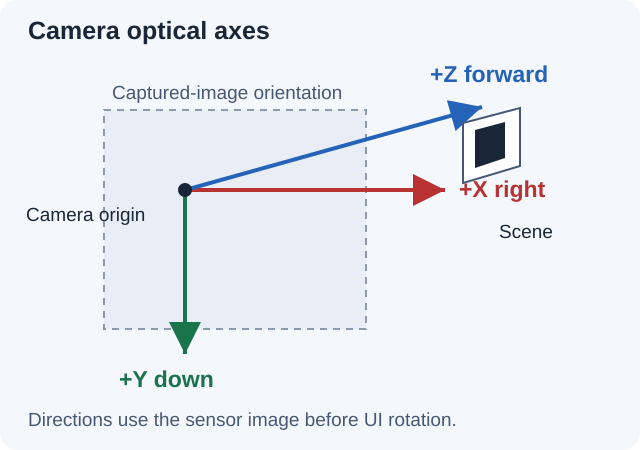
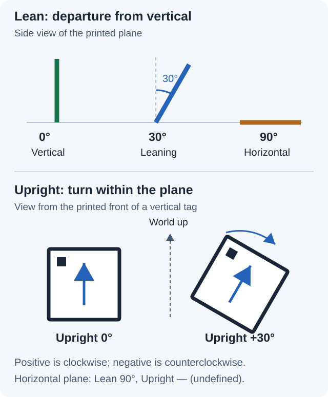
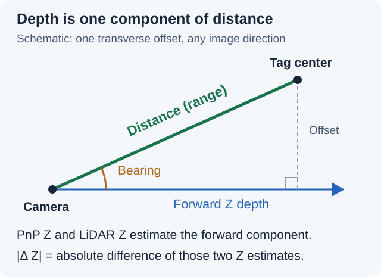
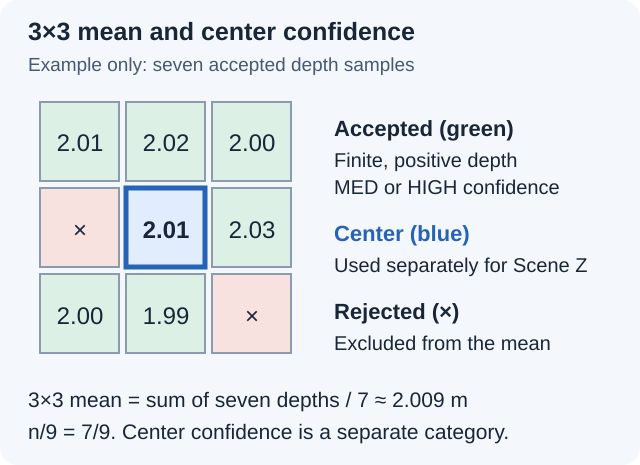

# Tag measurement glossary

## Overview

Tap a linked label in **Details** to jump to its definition here. This page and its diagrams are maintained in Markdown and bundled with the app so help is available offline.

**Coordinates:** [X right](#x-right) · [Y down](#y-down) · [Z forward](#z-forward) · [Cam roll](#camera-roll) · [Cam pitch](#camera-pitch) · [Cam yaw](#camera-yaw).

**Orientation:** [Gravity](#gravity) · [Tilt](#tilt) · [Twist](#twist) · [Plane](#plane) · [Bearing](#bearing).

**Depth and range:** [PnP Z](#pnp-z) · [LiDAR Z](#lidar-z) · [|Δ Z|](#delta-z) · [Distance](#distance) · [3×3 mean](#depth-mean) · [Confidence](#depth-confidence) · [n/9](#depth-neighbors).

**Quality and timing:** [RMS](#rms) · [Margin](#decision-margin) · [Hamming](#hamming) · [Edge / Auto / FTC / FRC / year](#edge) · [Hz](#analysis-rate) · [Age](#frame-age) · [Compute](#compute-time).

**Readout:** [Height](#height) · [Height source](#height-source) · [Kalman](#kalman) · [Tag ID](#tag-id) · [Status](#status) · [Units](#units).

All measurements describe the detected tag's **center** unless stated otherwise. A dash (**—**) means unavailable; it is different from a measured zero. The detailed pose, depth and orientation diagnostics are raw values, even when live height and distance smoothing is on. Passing the app's checks does not establish surveyed field accuracy.

## Camera coordinates

The translation readout locates the tag center relative to the camera in **optical coordinates**: **+X right, +Y down, +Z forward**, in meters. The origin is the camera's optical center. Directions refer to the captured sensor image before the preview is rotated or cropped for the screen.

These axes differ from ARKit's camera axes (+Y up, −Z forward) and from a robot or field coordinate system. They also differ from the optional colored **tag-local pose axes**, which begin at the tag center and rotate with the printed tag.

## X right

**X** is the tag center's horizontal displacement in optical camera coordinates. Positive is right in the captured image; negative is left. It is a distance in meters, not a pixel position. See [Camera coordinates](#camera-coordinates).

## Y down

**Y** is the tag center's vertical displacement in optical camera coordinates. Positive is down in the captured image; negative is up. It is measured in meters and changes when the camera rotates. It is separate from [height above the floor](#height).

## Z forward

**Z** is the forward component of the tag center's camera-relative position. A visible tag is in front of the camera and has positive Z. This is the same solved forward depth shown as [PnP Z](#pnp-z); it is shorter than [Distance](#distance) when the tag is off the optical axis.

## Camera roll

**Cam roll** is the X-axis component of the solved **tag-to-optical-camera rotation**, displayed in degrees. Together with camera pitch and yaw, it describes how the tag's local axes are oriented relative to the captured camera image. It is not a phone attitude or gravity measurement.

The app uses the rotation convention `R = Rz(yaw) Ry(pitch) Rx(roll)`. Near pitch ±90°, these Euler angles cannot uniquely separate roll and yaw; the rotation matrix remains authoritative, and the solver chooses roll = 0°. Use [Tilt](#tilt) and [Twist](#twist) for gravity-relative orientation.

## Camera pitch

**Cam pitch** is the Y-axis component of the tag-to-optical-camera rotation, in degrees. The complete convention and its singularity are defined under [Camera roll](#camera-roll). Moving or turning the phone can change these camera-relative angles for a stationary tag.

## Camera yaw

**Cam yaw** is the Z-axis component of the tag-to-optical-camera rotation, in degrees. The complete convention is defined under [Camera roll](#camera-roll). This value is not compass heading or the tag's heading on the field.

## Gravity

**Gravity** identifies the reference used for the neighboring Tilt and Twist values. The app combines the tag rotation with the camera's ARKit orientation from the **same captured frame**, then measures against gravity-aligned world up.

For a stationary tag, rotating the phone should leave these estimates approximately unchanged. Normal tracking and a current, unambiguous pose passing range, viewing-angle and decoder/reprojection checks are required. Floor selection is not required. The gravity calculation does not use depth, but [Auto size mode](#edge) needs LiDAR to resolve the physical width before that pose is available. Gravity defines vertical but supplies no absolute field heading.

## Tilt

**Tilt** is the unsigned angle by which the printed tag plane departs from **vertical**: **0° is vertical**, **90° is horizontal**. Leaning forward and backward by the same amount produce the same tilt. Rotating the print within its own plane changes twist without changing tilt.

This differs from [Plane](#plane), which describes the camera's viewing angle. It also differs from floor tilt, which measures a floor's departure from horizontal. The app computes tag tilt as `asin(abs(normal · worldUp))` using a unit tag-plane normal.

## Twist

**Twist** is the signed rotation of the printed square from upright **within the tag plane**, viewed from the **printed front**. **0° is upright**, positive is clockwise, negative is counterclockwise; the displayed range is −180° to +180°.

Upright comes from projecting gravity-defined world up into the tag plane. For a horizontal or nearly horizontal plane, that projection is too small to define an upright direction, so twist shows **—** while tilt can remain available. See the [Tilt and Twist diagram](#tilt).

## PnP Z

**PnP** means **Perspective-n-Point**: estimating a known object's position and orientation from its points in an image. In this app, the pose solver uses the detected tag's four corners and the matching camera intrinsics; its metric scale uses the **resolved physical width for that detection**. The width comes from Auto, an explicit field/year preset or a custom measurement, as described under [Edge](#edge).

**PnP Z** is the solved tag center's **forward optical depth**, in meters. It is also called **pose Z**. An incorrect resolved [Edge](#edge) scales the estimated translation and range. An explicit field/year or custom width allows pose solving without LiDAR; the default Auto mode uses matching-frame LiDAR to select that width. Until size is resolved, the app shows **—** rather than a pose with an assumed scale. Compare with [LiDAR Z](#lidar-z), and use [Distance](#distance) for straight-line camera-to-center range.

## LiDAR Z

**LiDAR** means **Light Detection and Ranging**. **LiDAR Z** is the matching AR frame's scene-depth sample at the detected tag-center pixel, expressed as forward optical depth in meters. The app accepts a finite, positive center depth with confidence **MED (1)** or **HIGH (2)**. LOW confidence or missing data shows **—**.

The [3×3 mean](#depth-mean) is a separate diagnostic and never substitutes for an unusable center sample. LiDAR Z is forward depth; the live tag card's **LiDAR distance** unprojects that sample through camera intrinsics to obtain straight-line range. These quantities differ off the optical axis.

## Delta Z

**|Δ Z|** is the absolute difference between the two forward-depth estimates: `abs(LiDAR Z − PnP Z)`, in meters. It has no sign. A value of 0.12 m means the two depth estimates differ by 12 cm.

The color uses Settings' depth thresholds: green is at or below the warning threshold; amber is above warning through rejection; red is above rejection. Defaults are **0.10 m warning** and **0.15 m rejection**. Missing data remains neutral. Agreement is a consistency check, not independent evidence of absolute accuracy. In [Auto size mode](#edge), the same LiDAR depth helps select the pose's physical scale, so depth agreement is partly a consequence of that selection.

The live tag card's **LiDAR Δ** instead compares the two **straight-line ranges**, optionally smoothed, and has its own display threshold. It is separate from this raw Z-depth difference.

## Distance

**Distance** is the straight-line Euclidean range from the camera's optical center to the tag center, estimated from the tag pose: `sqrt(X² + Y² + Z²)`, in meters. It equals PnP Z only when X and Y are zero.

For example, X = 3 m, Y = 0 m, Z = 4 m gives Distance = 5 m and Bearing ≈ 36.9°. The configured maximum range gates pose quality. Live tag cards also compare LiDAR-derived range with tag-derived range; the Details value remains the raw pose range. See the [depth/range diagram](#pnp-z).

## Plane

**Plane** is the unsigned **incidence angle** between a normal to the printed tag plane and the line of sight between camera and tag center: **0° is head-on**, **90° is edge-on**. A normal is a direction perpendicular to the flat printed surface. The app uses the acute angle regardless of normal sign.

This angle drives the maximum viewing-angle check (60° by default). It describes how obliquely the camera sees the tag, rather than the tag's lean relative to gravity. A vertical wall tag can have Tilt = 0° while Plane is large because you are viewing it from the side.

## Bearing

**Bearing** is the unsigned angle away from the camera's **forward optical axis** to the ray through the tag center: `atan2(sqrt(X² + Y²), Z)`, in degrees. A tag centered on the optical axis has bearing 0°; displacement in any image direction increases it.

It does not indicate left versus right, compass direction or field heading. It is independent of the tag's surface orientation: a tag can move away from image center while facing directly toward the camera. Compare with [Plane](#plane) and the [depth/range diagram](#pnp-z).

## Depth mean

**3×3 mean** is the arithmetic mean of accepted scene-depth pixels in a 3-by-3 neighborhood centered on the tag's depth-image pixel. Each contributing pixel must be finite, positive and have MED or HIGH confidence. The result is in meters.

Pixels can describe nearby background or an edge, especially for a small or distant tag. The neighborhood can contain fewer than nine candidates at image boundaries. Its mean does not replace the center value used for LiDAR Z or depth agreement.

## Depth confidence

**LOW / MED / HIGH** reports the **center depth pixel's** ARKit confidence category: LOW = 0, MED = 1, HIGH = 2. LOW is rejected by the app's depth checks. The word beside the 3×3 mean describes the center sample, not the confidence of the whole neighborhood.

These are categories, not calibrated percentages of accuracy. A missing confidence sample shows **—**; an unrecognized category shows **?**.

## Depth neighbors

**n/9** counts accepted depth samples contributing to the [3×3 mean](#depth-mean), including the center if accepted. For example, **7/9** means seven of the nine possible positions contributed. Image boundaries can reduce the number of candidate positions. A valid neighborhood mean can exist while the center sample remains unusable.

## RMS

**RMS** means **root mean square**. Here it is the tag's **corner reprojection error**, in image pixels: solve a pose, project the four physical tag corners back into the image, measure each corner's 2D distance from its detected position, then compute `sqrt(sum(du² + dv²) / 4)`.

A smaller value means the solved pose better fits the observed corners. The default rejection limit is 3 pixels. This differs from the pose solver's object-space error. Even a small RMS cannot verify the physical tag width, LiDAR accuracy or surveyed field position.

## Decision margin

**margin** is the AprilTag decoder's decision margin: the average separation between sampled data-bit intensities and the threshold used to classify them. Larger values generally indicate clearer binary decisions, especially for small tags; it is not a percentage or universal measure of pose accuracy.

The app requires a positive margin for its conservative pose-quality gate. Margin is evaluated together with [RMS](#rms), [Hamming](#hamming), ambiguity, range and incidence.

## Hamming

**H** reports the number of corrected data bits used to decode this detection's tag ID. **H0** means no corrections were needed; **H1** means one bit was corrected. This is a decoder diagnostic, not a height or a confidence percentage.

The app's conservative pose-quality checks require **H0** even if the detector can decode a tag with corrected bits. The number in a family name such as **tag36h11** describes that family's code separation and is a different quantity.

## Edge

**Edge** is the **resolved physical width for the selected detection**, measured along one tag side between its detection corners at the black/white boundary. It excludes the surrounding paper margin. The pose solver uses this length to establish metric scale. Different tags in the same frame can have different applied widths. **Edge —** means the width has not been resolved; it is not a zero-size tag.

**Field type** in Settings selects how size is resolved. **Auto (LiDAR)** is the default for new settings. It compares each detection's reference pose with the **same frame's HIGH-confidence center LiDAR depth**, then selects a unique supported nominal width. Normal tracking and a reliable, unambiguous corner pose are required. The supported widths are **50.8, 82.55, 101.6, 127, 152.4 and 165.1 mm** (2, 3.25, 4, 5, 6 and 6.5 inches). Matching tolerance is 10%, tightened to 3% for the nearby 6- and 6.5-inch sizes. If the necessary inputs or a unique match are missing, the tag ID and outline remain visible while its scaled pose is unavailable. Select an explicit field/year or custom width when needed.

**FTC** means **FIRST Tech Challenge**; **FRC** means **FIRST Robotics Competition**. Selecting one explicitly, together with **Competition year**, applies that season's known black-border sizes without requiring LiDAR to choose the width. FTC's year is the season's **ending year**: **FTC 2027** means the **2026–27 BIOBUZZ** season. FRC uses its calendar year: **FRC 2026** means **2026 REBUILT**. The initial choices when selecting these modes are FTC 2027 and FRC 2026.

- **FTC 2024: 2023–24 CENTERSTAGE:** 50.8 mm for IDs 1–6, 8 and 9; 127 mm for IDs 7 and 10.
- **FTC 2025: 2024–25 INTO THE DEEP:** 101.6 mm.
- **FTC 2026: 2025–26 DECODE:** 165.1 mm.
- **FTC 2027: 2026–27 BIOBUZZ:** 82.55 mm.
- **FRC 2024 CRESCENDO, 2025 REEFSCAPE, 2026 REBUILT:** 165.1 mm.

A CENTERSTAGE ID outside the known map leaves size unavailable. Single-size presets apply the nominal size under your explicit selection; that selection does not prove a print belongs to the competition.

The source beside Edge records how the width was chosen. **Auto** means LiDAR selected a nominal size; **Auto · FTC** or **Auto · FRC/FTC** identifies compatible size categories, not a confirmed competition or year. FTC and FRC share the tag36h11 family and overlapping IDs, and 6.5-inch tags are used by both FRC and FTC DECODE. Auto therefore leaves competition year unknown. Before a tag is selected, **Field Auto** or **FTC/FRC plus year** describes the configured size mode rather than a resolved measurement.

**Custom width / manual** uses an entered measurement. **AR estimate** uses an accepted two-point AR/LiDAR edge measurement and selects Custom width. An AR estimate is sensitive to tap placement, depth resolution and tracking; use a carefully measured physical width when available. Rescaled practice prints may need a custom width. Changing size settings invalidates results computed under the previous settings. On upgrade, the former untouched 165.1 mm FRC default becomes Auto; existing manual/AR widths remain Custom, and saved explicit field/year selections are retained.

## Analysis rate

**Hz** means analyses per second. The displayed rate comes from completed successful detector analyses over the recent approximately two-second window, rather than assuming every camera frame was analyzed. Fewer than two completions, or no recent completion, gives 0 Hz.

The camera targets 30 Hz. One analysis runs at a time; incoming work is skipped while that worker is busy. Consequently this rate can be lower than the camera frame rate and does not count detected tags.

## Frame age

**Age / Frame age** is the elapsed time since the analyzed camera frame was captured, in milliseconds. It includes processing and time until the readout is updated. It is separate from [compute time](#compute-time).

Results older than **400 ms** are cleared so a stale measurement is not presented as current. An unavailable or stale readout does not mean the actual measurement is zero.

## Compute time

**compute** is the worker's elapsed processing time for detection, pose solving and diagnostic enrichment of that frame, in milliseconds. It excludes time before the worker starts and later readout delivery. It is therefore normally less than frame age.

## Height

**↑ ≈ / Height** is the estimated tag-center height **vertically above the confirmed floor plane**, measured along gravity. It is not the tag's bottom-edge height, camera Y or camera-to-tag distance. For a slightly sloped floor, the app intersects a gravity-vertical line through the tag center with that plane.

Select and confirm a floor through **Measure** before height is available. Height is displayed in centimeters, optionally also feet and inches, while stored geometry uses meters. The approximation sign identifies an estimate.

## Height source

**LiDAR height** locates the tag center using the accepted center depth sample and camera intrinsics. **Pose height** uses the solved tag-center translation when scene depth is unavailable. Both are transformed with the source frame's camera pose and measured against the confirmed floor.

The pose fallback depends on the detection's [resolved tag width](#edge). Missing floor, unresolved size, poor tracking, stale or ambiguous pose, failed quality checks or unusable geometry can make height unavailable. A source label describes the measurement basis, not a guarantee of accuracy.

## Kalman

**Kalman** identifies the optional recursive smoothing applied to live tag heights and the separate live LiDAR/Tag camera ranges. Settings offers **3, 5, 10, 20 or 30 equivalent samples**; a larger value reduces jitter and adds lag. This is a filter strength, not a fixed-length moving average.

The filter resets when a tag or signal disappears, its source changes, tracking/floor/settings change or results expire. Detailed pose and depth values, Tilt, Twist, quality gates, world-space vectors, recordings and playback retain raw values. Smoothing changes readability and response, not measurement accuracy.

## Tag ID

**TAG #n** is the decoded identifier in the **tag36h11** family. It is a printed code identity, not an object tracker identity or a surveyed field location. The ID does not encode physical size or competition; see [Edge](#edge). Reusing an ID on multiple physical tags makes that identity ambiguous. Tap a tag's outline to select the tag shown in Details.

## Status

The title's status summarizes the current camera-relative checks. **VALID** means those checks pass; it does not certify absolute accuracy. The status color and the independently colored depth difference help identify different issues.

- **WAITING:** no usable current measurement, including an expired result.
- **SET TAG SIZE:** the detection's physical width is unresolved. Auto may lack suitable LiDAR/pose evidence or a unique size match; a selected mixed-size season may lack a size for this ID. Open Settings and choose the matching field/year or enter/measure a custom [Edge](#edge). The outline and ID can remain visible while pose-derived measurements show **—**.
- **TOO FAR:** solved range exceeds the configured maximum.
- **BAD ANGLE:** plane incidence exceeds the configured maximum.
- **CHECK DEPTH:** absolute depth difference exceeds warning but not rejection.
- **DEPTH MISMATCH:** absolute depth difference exceeds rejection.
- **MISSING DEPTH:** a usable center scene-depth sample is unavailable.
- **AMBIGUOUS:** a distinct alternative planar pose is too competitive to resolve confidently.
- **LOW CONFIDENCE:** decoder/reprojection checks or center depth confidence fail.
- **TRACKING LIMITED:** AR tracking is not normal.
- **POSE UNAVAILABLE:** a valid camera-relative pose or its quality data is missing.

When several checks fail, the displayed status is the first applicable check in the quality policy, rather than a list of all problems.

## Units

- **m:** meters; 1 m = 100 cm = 1,000 mm.
- **cm / mm:** centimeters / millimeters.
- **°:** degrees; 90° is a quarter turn.
- **px:** captured-image pixels.
- **Hz:** completed analyses per second.
- **ms:** milliseconds; 1,000 ms = 1 second.
- **ft / in:** feet / inches, optionally shown for heights.
- **Δ:** difference; vertical bars, as in **|Δ Z|**, mean absolute magnitude.
- **≈:** estimated or approximate value.
- **—:** unavailable data, distinct from zero.
