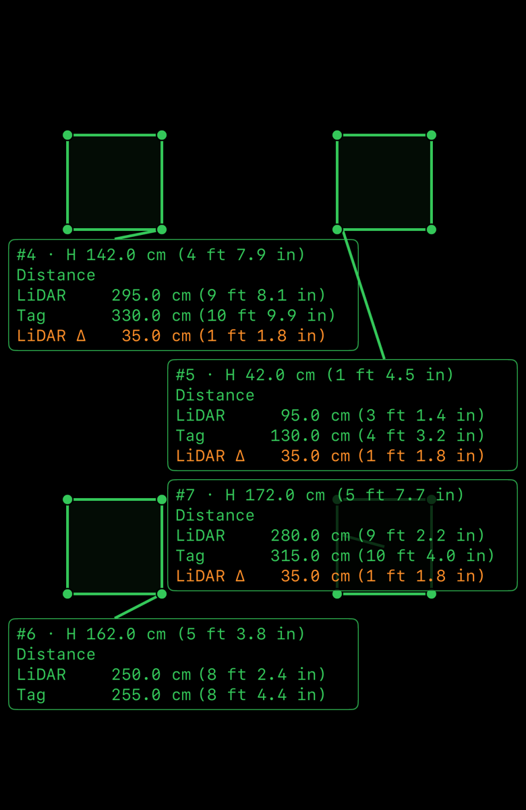
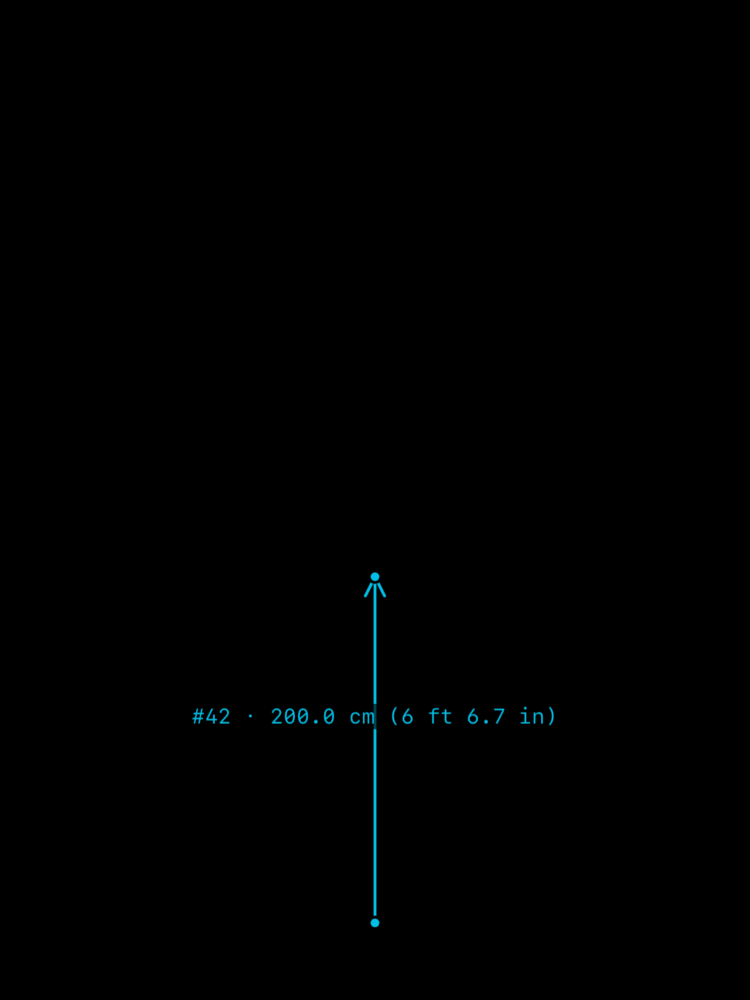

# Distance, floor tilt and live height vectors

Version 0.3.2 (build 14) labels the camera-to-tag-center comparison **Distance** and aligns LiDAR and tag-geometry numbers for comparison. The values are true Euclidean distances, including off-axis displacement; optical Z remains a separate diagnostic. The card adds **LiDAR Δ** only when both distances are valid and their absolute difference exceeds the saved threshold (default 15 cm).

Each usable tag also shows a gravity-vertical vector from its intersection with the confirmed floor to its center. The height label uses the world-space midpoint of that vector, projected through the current camera and zoom. These are live detections, not new manual measurements. The source frame, floor and coordinate segment must match; missing, stale or invalid estimates clear their vectors.

- [x] Native distance-delta, settings migration and validation tests, including robust floor fitting, depth sampling and observed/effective floor geometry.
- [x] Native numeric alignment, conditional delta, vector projection and lifetime tests: combined suite **105/105 passed**, zero failures. Result: `/tmp/aprilfools-distance-height-20261122/Results.xcresult`. The dedicated simulator was shut down after testing; the complete native integration typecheck passed.
- [x] React Native settings, threshold validation, tilt display and floor-leveling preference tests: 30/30 passed. TypeScript and ESLint passed.
- [x] Signed exact-revision Release build and embedded metadata verification: **0.3.2 (14)**, source `4155f733f1e38f0be0fa70ae3b0e324199fea1ad`, built `2026-11-22T18:04:09Z` from a clean tree. Strict/deep signature and embedded version/commit/build-date comparisons passed.
- [ ] Guarded iPhone installation/launch and verified release.
- [ ] Tester checks on real tags and floor in T0.1j.

Existing source measurements remain in meters. The display threshold does not change optical-Z warning/rejection limits or stored delta values. Height stays vertical with gravity on a slightly tilted floor, as requested; it is not the shorter perpendicular-to-plane distance. The physical handoff verifies installation and launch; real-field alignment and accuracy remain the tester's check.

The floor tilt display reports a LiDAR plane-fit estimate, with usable coverage and residual/inlier checks. [ARKit horizontal anchor rotations are constrained to be level](https://developer.apple.com/documentation/arkit/arplaneanchor/alignment-swift.enum/horizontal), so those rotations alone are not a physical slope measurement. Unavailable fits do not become a displayed zero. The saved **Level floor with gravity** option defaults off. When enabled, the effective measurement plane is horizontal at the confirmed floor center's elevation, with its displayed boundary at that same elevation. The original observed datum remains available for restoring the detected plane, and previous manual measurements retain their immutable floor snapshots. Provisional floor scanning still uses the observed plane until Done.

The bounded fit uses at most 512 high-confidence scene-depth points inside the selected floor footprint, with 0.1–5 m axial depth and heights within 0.5 m of the ARKit floor. It attempts a robust fit at most four times per second during setup. Fewer than 32 samples, weak spatial spread, under 65% inliers, slopes above 20° or residual RMS above 3 cm remain unavailable. These checks reject weak inputs; they are not a certified angular-accuracy bound. The fit's source frame, sample/inlier counts and residual are retained with the floor reference.

These simulator fixtures use the production native renderers. They verify layout and projection, not real-field detection or accuracy.

Installation is pending: the Mac-only Device Hub preflight reported that the Mac is locked and automatic unlock failed. No physical-device lease, remote capture or phone action was started for this update. The installed phone version remains **0.3.1 (13)** until the guarded handoff can run after manual unlock.

Ready package: `/tmp/april-fools-final-4155f73/AprilFoolsAR.app`. Build log: `/tmp/april-fools-distance-height-build.log`. Executable SHA-256: `2b0bf66375d447e07a8a697d752d7c30329e16542538fe64158f28c40333ad59`. Debug symbols are retained locally under ignored `crash-reports/2026-11-22/build14-4155f73/`.
