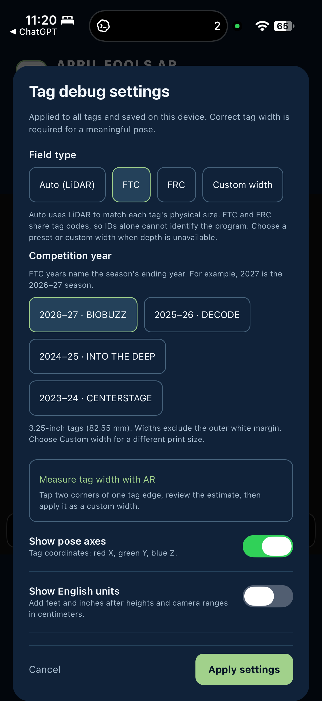

# Field and competition-year tag sizes

Version **0.10.0 (32)** was built from clean commit `45800a7dcb53f2f7980efbaf7008c288140c6bbd` at **2026-11-24T04:12:23Z**. The signed Release bundle passed signature and embedded-JavaScript verification. It was installed and launched on an iPhone 17 Pro running iOS 27.2.1; installed-app metadata and the visible version header confirmed version/build and source hash.

Settings now offers Auto (LiDAR), FTC, FRC and Custom width. Explicit field/year selections cover FTC 2023–24 through 2026–27 and FRC 2024–2026. CENTERSTAGE resolves its two nominal widths by the selected season's tag IDs. Auto selects physical size from same-frame high-confidence LiDAR; it does not establish competition identity or year. [Definitions, sizes and source references](../tag-debug-screen.md) describe the selection gates and supported seasons.

## Checks

- 71 React Native/Jest tests passed, including field/year selection, cancellation and precise custom-width preservation. TypeScript and ESLint passed with only existing lint warnings.
- 150 native simulator tests passed, including all supported field/year pairs, CENTERSTAGE's complete size map, scale consistency, weak/missing depth, invalid settings, persistence and selected-tag panel layout.
- Native capture/archive integration passed Swift typechecking against the iOS 27.2 SDK, with existing warnings.
- Physical installation, launch and visual settings display passed. FTC/year choices were previewed for the screenshot without applying changes. No recording or automation test runner was started; saved settings were preserved.
- Physical Auto-size accuracy with independently measured tags remains pending under T0.1l. The screenshot and a live depth status do not establish physical size inference accuracy.

## Native accessibility follow-up

**Failed for this session:** Device Hub exposed its host controls but no app controls in the physical phone's AX tree. Settings and the FTC preview required coordinate input. This is not a native accessibility pass. T0.1m in the [tester checklist](../../TESTER_CHECKLIST.md) tracks retesting with a native accessibility controller/VoiceOver and separating a controller bridge problem from an application defect. The screenshot does not close this follow-up.

## Phone release

All physical actions used the shared global device lease. Screen sharing was explicitly stopped; the only remaining Device Hub window showed enabled View Screen, keyboard capture off, and no live-view controls. The release checker initially rejected the observation because the tool's explanatory focus footer repeated the standard-window phrase. A fresh full AX tree, excluding that non-tree footer, passed capture verification. All owned deployment commands had exited and the guard's final status was **released**, with no errors, before documentation or handoff work resumed. No WDA/XCTest runner or phone recording was left active. Both temporary screenshot simulators were shut down and deleted.

## Screenshot

Actual phone screenshot, showing the unsaved FTC BIOBUZZ selection and available years:

