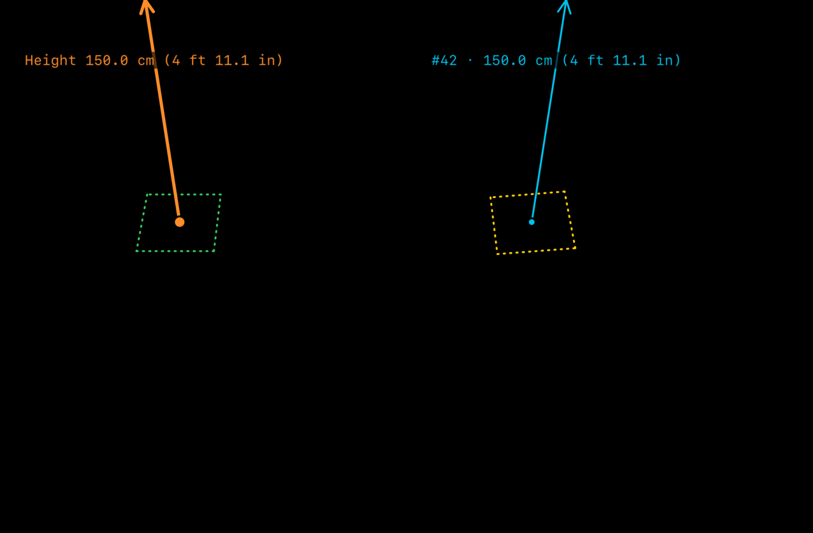

# Dotted floor references at height-vector bases

Version 0.4.1 (build 16) adds a 30 cm square centered on the floor foot of each live tag-height vector and saved manual floor-height vector. Its corners lie in that measurement's active floor plane. It is perpendicular to the gravity-vertical height vector when the floor is level; on a tilted floor it follows the slope so the difference is visible.

The outline uses small round dots with no fill. It is green for a known effective tilt at or below 0.5°, yellow above 0.5°, and neutral gray when physical tilt is unavailable. Gravity leveling produces a horizontal green reference; the observed tilt remains in the existing readout. Saved measurements use their original floor snapshot.

- [x] Native geometry tests for centering, side lengths, coplanarity and tilted/leveled references: six focused cases passed.
- [x] Native rendering tests for dotted style, colors, camera/zoom projection, clipping, reuse and expiry: six focused UIKit cases passed. Combined native suite: **119/119 passed**, zero failures. Result: `/tmp/aprilfools-floor-base-20261122/Results.xcresult`. Dedicated simulator shut down after testing.
- [x] TypeScript and all 33 JavaScript regression tests passed.
- [x] Exact-revision signed Release build and embedded metadata verification: **0.4.1 (16)**, source `03a727d9abb8f2ad7c095df69d75a1a2f6f17c29`, built `2026-11-22T19:03:56Z` from a clean isolated checkout. Strict/deep signature and embedded version/commit/build-date comparisons passed.
- [x] Guarded Device Hub in-place installation and launch on Doug's iPhone 17 Pro. Installed version/build and running process independently verified. All four finalized recording sessions retained with identical manifest checksums. Fresh full-window capture evidence passed; the global device guard returned `released` with no errors before repository work resumed. No recording, mirroring, phone-coordinate input or test runner was started.
- [ ] Tester checks on real floor/tag geometry in T0.1k.

These squares are visual references derived from existing floor and height evidence. They do not add new measurements. Each original edge is clipped separately so an offscreen square does not grow a false edge along the viewport boundary. Automatic references expire with their source tag; manual references follow their saved vectors' lifetime.

The production renderer was visually checked using this simulator fixture; it is not a physical floor measurement.

Installed package: `/tmp/april-fools-final-03a727d/AprilFoolsAR.app`. Build log: `/tmp/april-fools-floor-base-build.log`. Executable SHA-256: `ce9ca8919272a249c45bbe40a5ea66895be24421be0dadea30229b902ff8bab6`. Debug symbols are retained locally under ignored `crash-reports/2026-11-22/build16-03a727d/`. Real-floor alignment remains the tester's T0.1k check.
