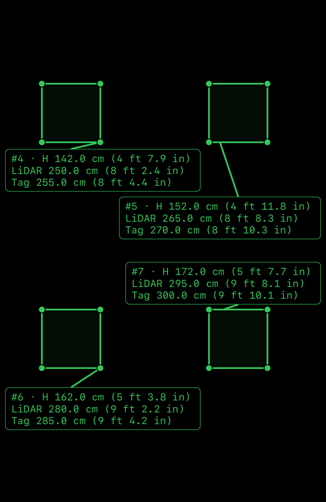

# Compact multi-tag camera diagnostics

Version 0.3.0 (build 12) shows floor height, LiDAR camera range and tag-geometry camera range for each visible tag in a compact live card. Text is smaller and regular-weight so several tags can be read together. The default selected-tag panel is 44 points high; full pose/depth diagnostics remain under Details.

Both displayed camera distances are Euclidean ranges to the tag center. LiDAR depth is unprojected with the source camera intrinsics before taking its norm. Tag range is calculated from the source optical translation. Raw optical-axis depth Z remains available separately in Details and recordings. The ranges remain available without a selected floor; only floor height requires that reference.

- [x] Camera-range geometry/provenance and unavailable-input checks passed, including off-axis Euclidean range versus optical Z and independent missing-source handling.
- [x] Multi-tag card content, placement, selection, regular 12-point font, unit preference and expiry checks passed, including four neighboring tags, tiny viewports, duplicate IDs, and card-before-quad selection.
- [x] Compact 44-point and expanded 270-point native panel regressions passed. Combined native suite: **65/65**, zero failures. JavaScript suites: **25/25**, TypeScript and ESLint passed. Native capture integration typecheck passed. Result: `/tmp/aprilfools-multitag-camera-ranges-20261122/Results.xcresult`.
- [ ] Signed Release build with exact source identity.
- [ ] Guarded in-place iPhone install/launch and verified global lease release.
- [ ] Tester checks of crowded real-field views and alignment in T0.1h.

Existing settings, raw meter units, stored sessions and manual measurement geometry are preserved. Displayed ranges are diagnostic estimates, not independently validated field measurements.

The simulator-rendered fixture below uses the production overlay with synthetic tag rectangles. It confirms the smaller card layout; it is not a physical field capture.

