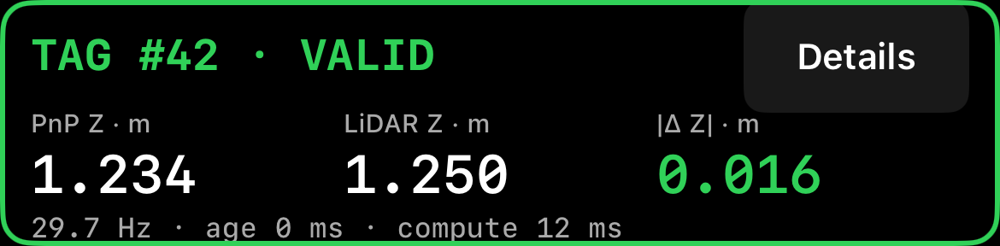

# Compact camera overlay revision

The previous debug view reserved 270 points below the camera. This revision keeps the AR camera, depth preview and tag outlines at the full preview bounds. The debug readout floats near the bottom, defaults to a translucent 96-point summary, and expands to the detailed readout only when requested. Expansion changes the overlay bounds, not the camera projection or tag coordinate mapping.

The compact view retains tag validity, PnP Z, LiDAR Z, colored difference and live timing. **Details/Collapse** has a 44-point touch target; other points pass through for tag selection. The host's tag-selection recognizer ignores control touches so the button does not also select a tag behind it.

The same update adds an opt-in **Show pose axes** setting. Red X, green Y and blue Z axes project from each solved tag center using the matching source-frame intrinsics and display transform. Missing or invalid pose/calibration cannot produce a gizmo. Existing tag-size settings survive migration, and changing this preference preserves measured-width precision and provenance.

## Validation

- [x] Native panel layout, expand/collapse, current values/colors and touch routing checks: nine tests pass, including long status labels, 44-point button, pass-through hit testing, value colors and 600 reused-view updates. A separate focused test passes for the visible Details/Collapse title after UIKit's deferred button rendering settles.
- [x] Native axis projection/overlay lifetime and settings migration checks: 18 tests pass. They cover camera coordinates and rotation, asymmetric intrinsics, screen transform, invalid calibration/pose, foreshortened Z, individual behind-camera endpoint rejection, 150 reused-axis updates, stale clearing and existing-width migration. All eight React Native tests, TypeScript and ESLint pass.
- [x] Signed iOS Release build 5 and strict/deep signature verification (working-tree build; exact-revision package below).
- [ ] In-place Device Hub installation on Doug's iPhone 17 Pro; compact and expanded views, mode switching and continued process execution.

This image uses test values to verify the native 390×96-point layout; it is not a physical measurement. The actual camera continues behind the translucent overlay.

Native results: `/tmp/aprilfools-compact-panel-regression-20261121-final/Results.xcresult` and `/tmp/april-fools-axis-regression-20261121/Results.xcresult`. Build log: `/tmp/april-fools-ar-overlay-build.log`.

Physical known-tag alignment and accuracy checks remain in T0.1a/M0.8; the full Milestone 0 field-data gate remains open.
