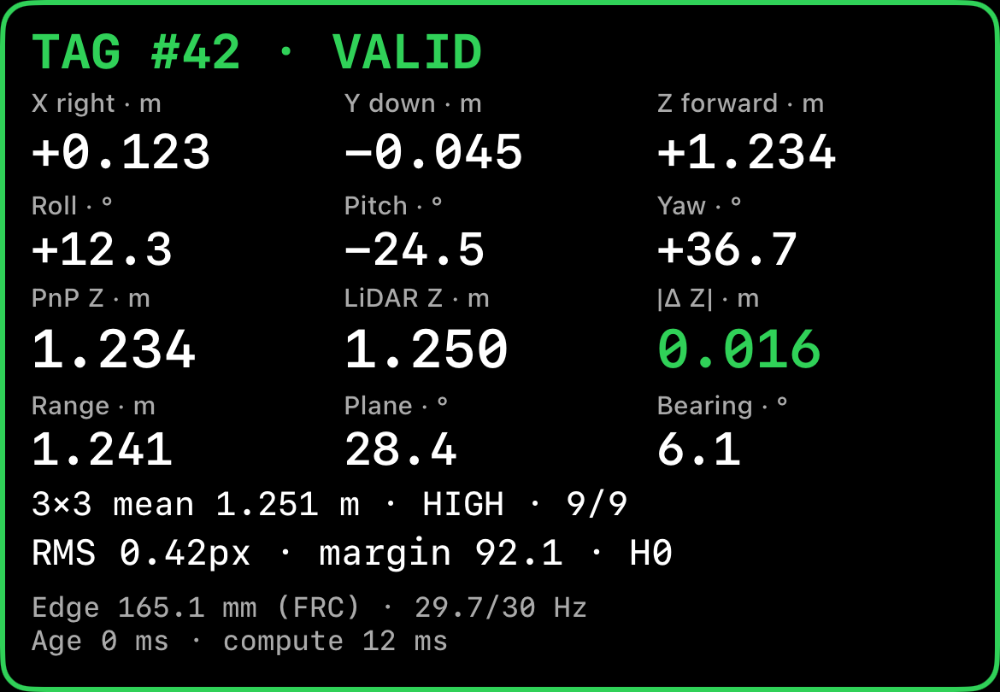

# AprilTag pose/depth debug screen validation

The debug screen adds camera-relative tag pose, frame-matched LiDAR comparison, explicit quality gates, and configurable tag width/thresholds. The implementation remains within the iOS-first native AR pipeline and shared C detector. See [the screen and coordinate definitions](../tag-debug-screen.md).

## Implemented behavior

- Native selected-tag readout with translation, ZYX roll/pitch/yaw, pose Z and range, LiDAR center and 3×3 mean, colored absolute Z difference, plane incidence/center bearing, reprojection RMS, decision margin, corrected bits and validity.
- Reused native labels and tag graphics, four corner dots, tap-to-select, a camera preview above the readout, and stale-result clearing.
- No fixed 8 Hz analysis throttle: one worker accepts available 30 Hz camera frames without building a queue. Actual measured rate, compute time and age are shown. Positive-detection JPEG snapshots are capped at 5 Hz while numeric analysis records remain intact.
- FRC 165.1 mm default width, manual override, and explicitly accepted two-point AR/LiDAR edge estimate. The AR override uses measured world endpoints, not the pose's assumed size. Width source and endpoint evidence are recorded.
- Persisted thresholds with missing/invalid evidence kept neutral. Depth comparison uses optical Z, not Euclidean range; the neighborhood mean never silently replaces a rejected center sample.

## Completed development checks

- Shared C solver tests: known frontal and oblique translations/rotations, in-plane rotation, off-axis geometry, near-frontal ambiguity behavior, tag-size scaling, independently calculated pixel RMS, and invalid/missing calibration or degenerate corners.
- Legacy decoded tag 42, blank image, padded stride and full-resolution corner tests pass.
- TypeScript and ESLint pass. All seven React Native tests pass, including displayed-unit conversion, explicit acceptance of an AR width estimate, full-precision width preservation during threshold edits, and explicit reset to the FRC default.
- The first signed iOS Release build 4 passes with the new native components.
- Native UIKit/math suite: 12 tests passed. It covers overlay reuse and expiry, optical-Z comparison, warning/rejection boundaries, confidence/missing/NaN inputs, row-stride/normalized depth mapping and neighborhood mean, settings persistence, AR-width validation and matching evidence snapshots.
- Native panel suite: five tests passed for readable metrics, missing/ambiguous states, independent delta colors, threshold boundaries, and 600 updates without recreating labels/layers. The final no-tag telemetry case also passed separately after adding assertions for actual analysis rate, frame age and compute time.

Reproduction commands:

```sh
sh native/AprilTag/tests/run-smoke.sh
ruby native/ARCapture/tests/run-uikit-regression.rb --work-dir /tmp/aprilfools-debug-math-overlay
ruby native/TagDebugPanelTests/run-uikit-panel-regression.rb
npx tsc --noEmit
npm run lint -- --quiet
npm test -- --runInBand
./scripts/build-ios.sh
```



This is a UIKit test fixture, not a physical tag measurement. The image verifies the 390 × 270 point layout and the visible timing footer.

## Preliminary phone check

A working-tree Release build 4 was installed in place through Device Hub on Doug's iPhone 17 Pro (iOS 27.2.1). The app launched, the native no-tag panel rendered, Settings showed the expected defaults, and switching to Measure worked. The analyzed-frame count advanced from 1,280 to 2,155 with displayed compute times around 9–10 ms. No known tag was in view, tracking was limited/initializing, and depth was waiting, so this check does not establish pose/depth accuracy or sustained analysis rate. The AR-width action was subsequently moved immediately below the width field for easier access; the exact-revision installation below checks the final layout.

## Remaining checks for this build

- [x] Native UIKit/quality-gate regression results and rendered panel inspection.
- [ ] Final exact-revision build/signature verification and in-place Device Hub installation.
- [ ] Real tag: pose and depth values, selection, threshold colors, manual/AR width override, disappearance/expiry, and sustained actual analysis rate.
- [ ] Captured debug data decoded outside the phone using `scripts/inspect-session.py --require-debug`.

Unit geometry and simulator UI checks do not establish field measurement accuracy. The real-field acquisition/review gate in PLAN.md remains open.
